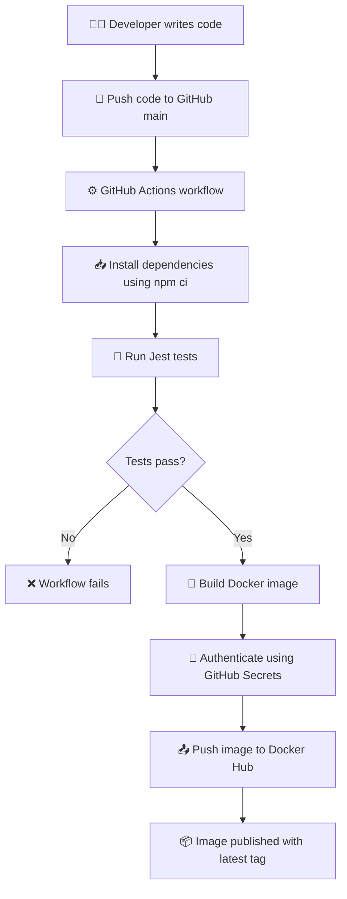

# 🚀 Node.js CI/CD Pipeline Using GitHub Actions and Docker


## 📌 Project Overview

This project demonstrates how to automate application testing, Docker image building, and image publishing using a **Continuous Integration and Continuous Deployment (CI/CD) pipeline**.

Whenever code is pushed to the `main` branch, GitHub Actions automatically runs the Node.js tests. If the tests pass, the workflow builds a Docker image and pushes it to Docker Hub.

🎯 **Goal:** Automate testing and container image publishing using free developer tools.

## 🎯 Project Objectives

- ✅ Automate Node.js application testing.
- ⚙️ Implement CI/CD using GitHub Actions.
- 🐳 Build a Docker image for the application.
- 📦 Publish the image to Docker Hub.
- 🔐 Manage credentials securely using GitHub Actions Secrets.
- 🧪 Verify the application and health endpoint locally.
- 📸 Document the project with screenshots.

## 🛠️ Technology Stack

| Technology | Purpose |
|---|---|
| 🟢 Node.js | Application runtime |
| 🧪 Jest | Automated testing |
| 🔧 Git | Version control |
| 🐙 GitHub | Source code repository |
| ⚙️ GitHub Actions | CI/CD automation |
| 🐳 Docker | Application containerization |
| 📦 Docker Hub | Container image registry |
| 🐧 WSL Ubuntu | Development environment |

## 🏗️ Architecture Diagram



## 🔄 CI/CD Workflow

1. **👩‍💻 Code Push:** The developer pushes changes to the GitHub `main` branch.
2. **⚙️ Workflow Trigger:** GitHub Actions starts the pipeline.
3. **📥 Dependency Installation:** The workflow installs dependencies using `npm ci`.
4. **🧪 Automated Testing:** Jest runs the application's test suite.
5. **🐳 Docker Build:** If the tests pass, Docker builds the application image.
6. **🔐 Authentication:** GitHub Actions uses repository secrets to authenticate to Docker Hub.
7. **📤 Image Publishing:** The workflow pushes the image to Docker Hub with the `latest` tag.

### 🔗 Project Links

- 🐙 **GitHub Repository:** [View Source Code](https://github.com/ruchi1792/nodejs-demo-app-Elevate-labs)
- ⚙️ **GitHub Actions:** [View Workflow Runs](https://github.com/ruchi1792/nodejs-demo-app-Elevate-labs/actions)
- 📦 **Docker Hub:** [Open Docker Hub Repositories](https://hub.docker.com/repositories)

## 📂 Project Structure

```text
nodejs-demo-app/
├── .github/
│   └── workflows/
│       └── main.yml
├── screenshots/
│   ├── 01-project-setup.png
│   ├── 02-tests-passed.png
│   ├── 03-docker-build.png
│   ├── 04-docker-container.png
│   ├── 05-application-verified.png
│   ├── 06-github-repository.png
│   ├── 07-workflow-configuration.png
│   ├── 08-workflow-configuration.png
│   ├── 09-pipeline-success.png
│   ├── 10-pipeline-success.png
│   └── 11-dockerhub-latest.png
├── test/
│   └── app.test.js
├── .gitignore
├── Dockerfile
├── package.json
├── package-lock.json
└── README.md
```

## 💻 Run the Application Locally

### 📋 Prerequisites

Install Git, Node.js, npm, and Docker. Ensure Docker is running.

### 1️⃣ Clone the repository

```bash
git clone https://github.com/ruchi1792/nodejs-demo-app-Elevate-labs.git
cd nodejs-demo-app-Elevate-labs
```

### 2️⃣ Install dependencies

```bash
npm ci
```

### 3️⃣ Run automated tests

```bash
npm test
```

### 4️⃣ Build the Docker image

```bash
docker build -t nodejs-demo-app:local .
```

### 5️⃣ Run the container

```bash
docker run -d --name nodejs-demo-container -p 3000:3000 nodejs-demo-app:local
```

### 6️⃣ Verify the application

```bash
curl http://localhost:3000
```

Expected response:

```json
{
  "message": "Node.js Demo App is running!",
  "status": "success",
  "project": "CI/CD Pipeline using GitHub Actions and Docker"
}
```

### 7️⃣ Check the health endpoint

```bash
curl http://localhost:3000/health
```

Expected response:

```json
{"status":"healthy"}
```

### 8️⃣ Check the running container

```bash
docker ps
```

> 💡 If the container name already exists, remove the old container before running the command again:
>
> ```bash
> docker rm -f nodejs-demo-container
> ```

## 🔐 GitHub Actions Secrets

Configure the following repository secrets under **Settings → Secrets and variables → Actions**:

- `DOCKERHUB_USERNAME` — your Docker Hub username.
- `DOCKERHUB_TOKEN` — a Docker Hub access token with permission to push images.

⚠️ **Security:** Never commit access tokens, passwords, or other sensitive credentials to GitHub.

## 📸 Project Screenshots

The following screenshots document the project from initial setup through successful CI/CD execution and image publishing.

### 1. 🧰 Project Setup


### 2. 🧪 Automated Tests Passed


### 3. 🐳 Docker Image Build


### 4. 📦 Docker Container Running


### 5. 🌐 Application Verification


### 6. 🐙 GitHub Repository


### 7. ⚙️ Workflow Configuration — View 1


### 8. ⚙️ Workflow Configuration — View 2


### 9. ✅ Successful CI/CD Pipeline — View 1


### 10. ✅ Successful CI/CD Pipeline — View 2


### 11. 🚀 Docker Hub Image Published


## 🏆 Project Results

- ✅ Automated Node.js tests run through GitHub Actions.
- ✅ Docker images are built after successful tests.
- ✅ Docker images are published to Docker Hub.
- ✅ The application runs locally inside a Docker container.
- ✅ Project setup and pipeline execution are documented with screenshots.

## 🔮 Future Improvements

- 📊 Add test coverage reporting.
- 🛡️ Add security and dependency scanning.
- ☁️ Deploy the container to a cloud platform.
- 🚦 Add staging and production deployment stages.

## 👩‍💻 Author

Created as part of a **DevOps Internship Project** focused on CI/CD automation using GitHub Actions and Docker.

⭐ If you find this project useful, consider starring the repository!
