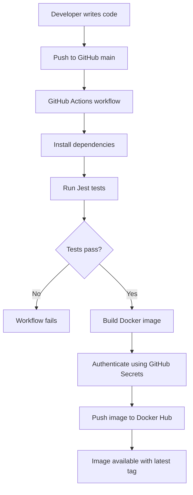

# Node.js CI/CD Pipeline Using GitHub Actions and Docker

## Project Overview

This project demonstrates how to automate testing, Docker image building, and image publishing using a Continuous Integration and Continuous Deployment (CI/CD) workflow.

Whenever code is pushed to the `main` branch, GitHub Actions runs the automated tests. If the tests pass, the workflow builds a Docker image and pushes it to Docker Hub.

## Objectives

- Automate Node.js application testing.
- Use GitHub Actions to implement a CI/CD workflow.
- Build a Docker image for containerization.
- Publish the image to Docker Hub.
- Store credentials securely using GitHub Actions Secrets.
- Verify the application locally using Docker.

## Technology Stack

- **Application:** Node.js
- **Testing:** Jest
- **Version Control:** Git and GitHub
- **CI/CD:** GitHub Actions
- **Containerization:** Docker
- **Image Registry:** Docker Hub
- **Development Environment:** WSL Ubuntu on Windows

## Architecture Diagram



## CI/CD Workflow

1. **Code push:** The developer pushes changes to the GitHub `main` branch.
2. **Workflow trigger:** GitHub Actions starts the pipeline.
3. **Dependency installation:** The workflow installs Node.js dependencies using `npm ci`.
4. **Automated testing:** Jest runs the application tests.
5. **Docker image build:** If the tests pass, Docker builds the application image.
6. **Authentication:** GitHub Actions uses repository secrets to authenticate to Docker Hub.
7. **Image publishing:** The workflow pushes the image to Docker Hub with the `latest` tag.

## Project Structure

```text
nodejs-demo-app/
├── .github/
│   └── workflows/
│       └── main.yml
├── screenshots/
├── test/
│   └── app.test.js
├── .gitignore
├── Dockerfile
├── package.json
├── package-lock.json
└── README.md
```

The exact file structure may vary depending on the application files in the repository.

## Run the Application Locally

### Prerequisites

Install Git, Node.js, npm, and Docker.

### Install dependencies

```bash
npm ci
```

### Run tests

```bash
npm test
```

### Build the Docker image

```bash
docker build -t nodejs-demo-app:local .
```

### Run the container

```bash
docker run -d --name nodejs-demo-container -p 3000:3000 nodejs-demo-app:local
```

### Verify the application

Open a second terminal and run:

```bash
curl http://localhost:3000
```

Expected response:

```json
{
  "message": "Node.js Demo App is running!",
  "status": "success",
  "project": "CI/CD Pipeline using GitHub Actions and Docker"
}
```

Check the health endpoint:

```bash
curl http://localhost:3000/health
```

Expected response:

```json
{"status":"healthy"}
```

Check the running container:

```bash
docker ps
```

## GitHub Actions Secrets

Configure these repository secrets under **Settings → Secrets and variables → Actions**:

- `DOCKERHUB_USERNAME` — your Docker Hub username.
- `DOCKERHUB_TOKEN` — a Docker Hub access token with permission to push images.

Never commit access tokens, passwords, or other credentials to the repository.

## Screenshots

Project screenshots are stored in the `screenshots/` directory.

| Screenshot | File |
|---|---|
| GitHub Actions pipeline showing successful jobs | `screenshots/github-actions-success.png` |
| Docker Hub repository showing the `latest` tag | `screenshots/dockerhub-image.png` |
| Application response in the terminal or browser | `screenshots/application-running.png` |
| Successful automated tests | `screenshots/jest-tests.png` |
| Running Docker container | `screenshots/docker-container.png` |

Add the corresponding image files to the folder to display them in this README.

## Results

- Automated Node.js tests run through GitHub Actions.
- Docker images are built after successful tests.
- Docker images are published to Docker Hub.
- The application can be run locally as a Docker container.

## Future Improvements

- Add code coverage reporting.
- Add security and dependency scanning.
- Deploy the container to a cloud platform.
- Add a staging and production deployment stage.

## Author

Created as part of a DevOps internship project focused on CI/CD automation using GitHub Actions and Docker.
